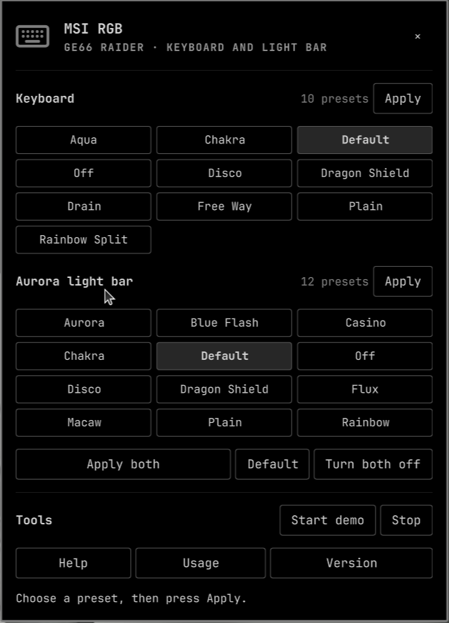

# MSI RGB for Omarchy

Control your MSI GE66 Raider's keyboard and Aurora light bar from the Omarchy
bar. A native Quickshell popup for `msi-rgb`, with an English interface and all
of its preset controls.



## Features

- All 10 keyboard presets and 12 Aurora light-bar presets.
- Apply keyboard and light-bar selections separately or together.
- Restore default presets or turn both lighting zones off.
- Start and stop the CLI's roughly 30-second preset demonstration.
- View help, usage, version information and copyable command output.
- Visible errors, hardware-access locking and bounded process cancellation.
- Native Omarchy styling and a scrollable popup.

Opening or loading the panel never changes your lighting. No startup hooks,
background server, automatic theme synchronization or root runtime.

## Compatibility and dependencies

- Linux with Omarchy Quattro's plugin system and Quickshell.
- Python 3.11 or newer (standard library only).
- `/usr/bin/msi-rgb` from the Arch/AUR package
  [msi-ge66-raider-rgb-git](https://aur.archlinux.org/packages/msi-ge66-raider-rgb-git).
- A compatible MSI GE66 Raider keyboard and Aurora controller, accessible to
  your desktop user.

Developed and smoke-tested on an **MSI Raider GE66 12UH**, with SteelSeries KLC
`1038:113a` and ALC `1038:113c`. Other models have not been verified. This
plugin does not control mice or implement a new USB/HID protocol; compatibility
comes from the installed
[msi-ge66-raider-rgb](https://github.com/luisalbertopm/msi-ge66-raider-rgb)
backend. Install that backend before adding the plugin:

```sh
yay -S msi-ge66-raider-rgb-git
msi-rgb --help
```

Custom colors, brightness sliders and current-effect readback are not available
in this backend. Only its preset commands are exposed.

## Install

```sh
omarchy plugin add https://github.com/bevebkba/omarchy-msi-rgb.git --enable
```

No setup script or privileged install step is required by the plugin itself.
The dependency and device permissions must already be in place. Plugin ID:
`io.github.bevebkba.msi-rgb`.

```sh
omarchy bar move io.github.bevebkba.msi-rgb --section right
```

For a local checkout, `bash install.sh` copies the plugin into your user plugin
directory, backs up `shell.json`, and enables the widget. Other widgets are
preserved. It creates no startup or theme hooks.

## Use

Click the keyboard icon with the tooltip **MSI RGB · Keyboard and light bar**.
Select a preset, then click **Apply** in that zone. **Apply both** submits both
selected presets. **Default** restores both defaults; **Turn both off** disables
both zones. Selecting a preset alone does not write to the hardware.

**Start demo** cycles the backend's paired presets. **Stop** terminates only the
command started by this widget. The last lighting effect remains active; use
**Default** to restore factory presets afterwards. Closing the popup lets the
demo continue. Unloading the plugin terminates its running child process.

**Help**, **Usage** and **Version** show the installed CLI's output. Output is
selectable and copyable. **Last sent** records the last successful request in
this shell session, not a device readback. Selections are not saved between
shell sessions.

### Presets

Keyboard: `aqua`, `chakra`, `default`, `disable`, `disco`, `dragon_shield`,
`drain`, `free_way`, `plain`, `rainbow_split`.

Aurora: `aurora`, `blue_flash`, `casino`, `chakra`, `default`, `disable`, `disco`,
`dragon_shield`, `flux`, `macaw`, `plain`, `rainbow`.

## Troubleshooting

**Device or permission error:** inspect the panel's output. Check that
`/usr/bin/msi-rgb` exists and your desktop user can access both HID devices.
Resolve access through device-specific udev rules; do not run the Omarchy shell
as root. The backend opens both devices even when applying only one zone.

**Device busy:** another widget instance is using the hardware. Stop its demo
or wait for it to finish. Unrelated RGB utilities do not share this plugin's
lock; avoid applying their effects simultaneously.

**Changed backend:** this release targets `msi-rgb` 0.1's preset catalog.
Compare `msi-rgb --help` to the lists above after updating the backend.

## Process behavior

Commands use validated argument arrays and the fixed `/usr/bin/msi-rgb`
executable. There is no shell interpolation, network access or privilege
escalation. A per-user lock serializes hardware commands across widget
instances. HID errors printed with exit code zero still count as failures.

Commands time out after 10 seconds, or 60 seconds for demo. Stop allows one
second for graceful termination before killing the child. Linux parent-death
handling kills a child if the shell kills its supervisor; the device lock is
held by both processes until they exit.

## Development and tests

```sh
python -m unittest discover -s tests -v
quickshell --no-color -p "$PWD/SmokeTest.qml"
omarchy plugin validate "$PWD"
```

Python tests replace only the external USB executable. They cover validation,
errors, locking, timeouts and process cleanup. The installed-backend catalog
check skips when `/usr/bin/msi-rgb` is absent.

The Quickshell smoke test requires the backend and must print `GE66_SMOKE_PASS`;
exit status alone is insufficient. It checks catalog loading, real version
output, GUI error reporting and last-success state without changing lighting.
Scanner warnings about unused native UI imports are expected outside the main
shell.

## Remove

```sh
omarchy plugin disable io.github.bevebkba.msi-rgb
omarchy plugin remove io.github.bevebkba.msi-rgb --yes
```

The plugin creates no system files or startup hooks. Removing it does not remove
the separately installed backend or change the current device lighting.

## License and credits

MIT license; see [LICENSE](LICENSE).

This is an independent GUI frontend. The external
[msi-ge66-raider-rgb](https://github.com/luisalbertopm/msi-ge66-raider-rgb)
backend is distributed under GPL-3.0. Backend source and preset packet data are
not bundled here. Not affiliated with MSI, SteelSeries or the Omarchy project.
